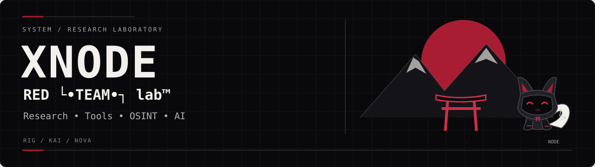

<p align="center"></p>

[Штаб лаборатории](https://github.com/Xnode-sh) · [Профиль XNODE](https://github.com/Xnode-sh)

# vault — приватное шифрованное хранилище для Termux

**Без облака. Без root. Всё на телефоне.**

`vault` прячет заметки и файлы в один зашифрованный каталог. Каждая запись шифруется **AES-256-GCM**, ключ выводится из пароля через **scrypt**. Без пароля содержимое не восстановить — в том числе разработчику.


## Зачем

На телефоне нет удобного места для паролей, токенов, черновиков и приватных файлов: заметки синхронизируются в облако, мессенджеры хранят историю, файловые менеджеры читают всё подряд. `vault` держит данные в одном локальном каталоге, зашифрованном паролем, с правами `600` / `700`.

## Безопасность

| Слой | Реализация |
|---|---|
| Шифр | AES-256-GCM (аутентифицированный: подмена данных обнаруживается) |
| Ключ | scrypt, `n=32768, r=8, p=1`, соль 16 байт |
| Nonce | случайный 12 байт на каждую запись |
| Целостность | GCM-тег, AAD `VAULT1` |
| Метаданные | индекс записей тоже зашифрован |
| Права | каталог `700`, файлы `600` |
| Пароль | нигде не хранится; в памяти на время команды |

Неверный пароль и повреждение данных дают одну и ту же ошибку — без подсказок атакующему.

## Установка

```bash
pkg install python python-cryptography
git clone https://github.com/Xnode-sh/vault.git
cd vault
python vault.py --help
```

## Использование

```bash
# создать хранилище (по умолчанию ~/.vault)
python vault.py init

# положить текст из stdin
echo "секретная заметка" | python vault.py put note -

# положить файл с заметкой
python vault.py put keys ~/id_rsa -n "ssh key"

# список
python vault.py ls

# показать текст
python vault.py cat note

# достать файл
python vault.py get keys ~/restored.rsa

# сменить пароль
python vault.py passwd

# удалить
python vault.py rm note
```

Каталог хранилища задаётся флагом `--vault DIR` или переменной `VAULT_DIR`. Для неинтерактивного использования пароль берётся из `VAULT_PASSWORD`.

### Резервные копии

```bash
python vault.py export ~/vault-backup.tar.gz
python vault.py import ~/vault-backup.tar.gz --vault ~/.vault-restored
```

Архив остаётся зашифрованным — храните и передавайте его как есть.

## Формат

```
~/.vault/
├── config.json   # публично: версия, KDF-параметры, соль
├── index.enc     # зашифрованный список записей и метаданных
└── data/<id>.enc # зашифрованное содержимое (nonce + ciphertext)
```

## Команды

| Команда | Назначение |
|---|---|
| `init` | создать хранилище |
| `put NAME [PATH\|-]` | положить запись |
| `get NAME [PATH\|-]` | достать запись |
| `cat NAME` | показать текст |
| `ls [--json]` | список записей |
| `rm NAME` | удалить запись |
| `passwd` | сменить пароль |
| `info` | сведения о хранилище |
| `export PATH` | архив для бэкапа |
| `import PATH` | восстановить из архива |

## Тесты

```bash
python -m unittest discover -s tests -v
```

## Ограничения

- Пароль не восстанавливается: забудете — данные потеряны.
- Защита держится на стойкости пароля, а не на «спрятанности» файла.
- Пока нет защиты от параллельной записи из нескольких процессов.

## Лицензия

MIT © 2026 Xnode-sh — RED └•TEAM•┐ lab™
